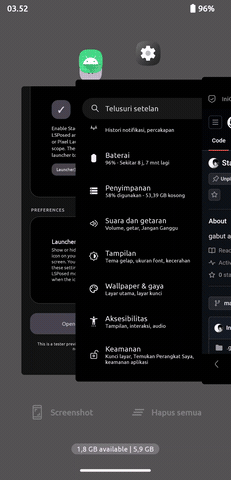

<div align="center">

# StackRecentAOSP

**iOS-style stacked cards for the Recent Apps screen on AOSP Launcher3 and Pixel Launcher.**

[](#compatibility)
[](https://github.com/LSPosed/LSPosed)
[](../../releases)



</div>

---

## Contents

- [Overview](#overview)
- [Features](#features)
- [Fixes](#fixes)
- [Compatibility](#compatibility)
- [Installation](#installation)
- [Settings](#settings)
- [Troubleshooting](#troubleshooting)
- [Build from source](#build-from-source)
- [Credits](#credits)

---

## Overview

StackRecentAOSP is an LSPosed module that replaces the flat carousel of the Recent Apps screen with a layered stack of cards. Cards overlap, scale and fade by their distance from the focused card, so the screen feels closer to the multitasking view of iOS while staying inside your stock launcher.

| | |
|---|---|
| **Package ID** | `com.yan.stackrecentaosp` |
| **Version** | 1.0.0 |
| **Minimum Android** | Android 12 (API 31) |
| **Framework** | LSPosed / Xposed API |
| **Developer** | **YAN** |

## Features

- Stacked recent cards with adjustable spacing and tightness.
- Stable 28 dp corner radius on task cards and thumbnails, whichever icon-mask shape your ROM uses.
- Landscape-aware stack that follows the carousel axis when the screen is rotated.
- More Material design (AOSP style) in the settings screen, with dynamic colors.
- **Force stop** shortcut for the launcher, available from the LSPosed module settings (**Launcher maintenance**).
- Launcher icon hidden by default; the settings stay reachable from the LSPosed module page.

## Fixes

- **Animation bug fix** – Recent Apps animations stay smooth and the running app lines up with its card.
- **Recent app slide fix** – sliding the navigation bar to switch between apps no longer shows another app on top of the current one.
- **Landscape mode fix** – cards, offsets and dismiss gestures behave correctly when the layout is rotated.

## Compatibility

| Launcher | Package |
|---|---|
| AOSP Launcher3 | `com.android.launcher3` |
| Pixel Launcher | `com.google.android.apps.nexuslauncher` |

> [!NOTE]
> Launcher internals differ between ROMs, Android versions and launcher forks. A matching package name does not guarantee that every hook behaves identically, so please test on your own device and ROM.

## Installation

1. Install the APK.
2. Open **LSPosed Manager**, enable **StackRecentAOSP** and add your active launcher to the module scope.
3. Open the module settings from LSPosed, go to **Launcher maintenance → Open launcher settings**, and tap **Force stop** on the launcher's App info page.
4. Go back to the Home screen and open Recent Apps. If nothing changes, reboot once.

## Settings

| Setting | What it does | Default |
|---|---|---|
| **Card spacing** | How far apart the stacked cards sit. | 4.7 |
| **Card tightness** | How strongly cards pull together toward the stack. | 0.72 |
| **Show launcher icon** | Shows or hides the app icon on the Home screen. | Off |
| **Open launcher settings** | Opens App info of the default Home app for a manual **Force stop**. | – |

Changes are read the next time Recent Apps updates; force-stop the launcher if a value does not seem to apply.

## Troubleshooting

<details>
<summary><b>Recent Apps looks unchanged</b></summary>

Check that the module is enabled, that your launcher is in the module scope and that it is one of the supported packages, then force-stop the launcher or reboot.
</details>

<details>
<summary><b>The app icon is missing from the Home screen</b></summary>

This is intentional. Open LSPosed Manager, tap the module, open its settings and switch on **Show launcher icon**.
</details>

<details>
<summary><b>"Could not detect the default launcher"</b></summary>

No Home app is set as default, so Android shows a chooser. Pick your launcher as the default Home app in system settings and try again.
</details>

<details>
<summary><b>Something looks wrong</b></summary>

Please open an issue with your device, Android version, ROM and launcher version, the steps to reproduce, a screen recording and the relevant LSPosed log lines. Remove personal information first.
</details>

## Build from source

Requirements: **JDK 21**, Android SDK Platform **36.1** and Build Tools **36.0.0**.

```bash
git clone https://github.com/IniGwYaN/StackRecentAOSP.git
cd StackRecentAOSP
./gradlew assembleRelease
```

On Windows use `gradlew.bat`. The APK is written to `app/build/outputs/apk/release/`.

## Credits

- Developed and maintained by **[YAN](https://github.com/IniGwYaN)**.
- thanks to : [C70246247](https://github.com/C70246247).for example this project
- [Android Open Source Project](https://source.android.com/), [LSPosed](https://github.com/LSPosed/LSPosed), [AndroidX](https://github.com/androidx/androidx) and [Material Components](https://github.com/material-components/material-components-android).

---

<div align="center">

*StackRecentAOSP is an independent community module and is not affiliated with Google or the Android Open Source Project.*

**Developed by YAN**

</div>
